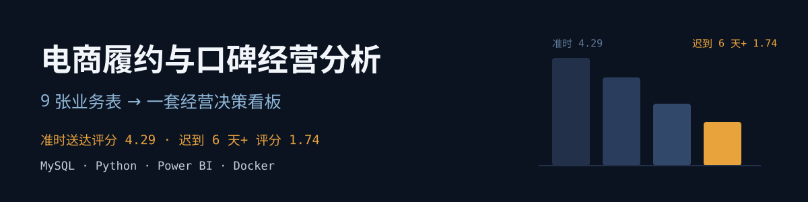
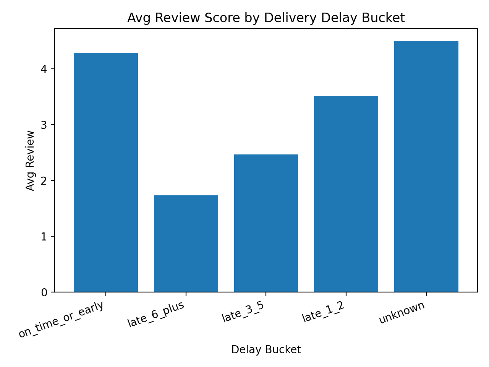
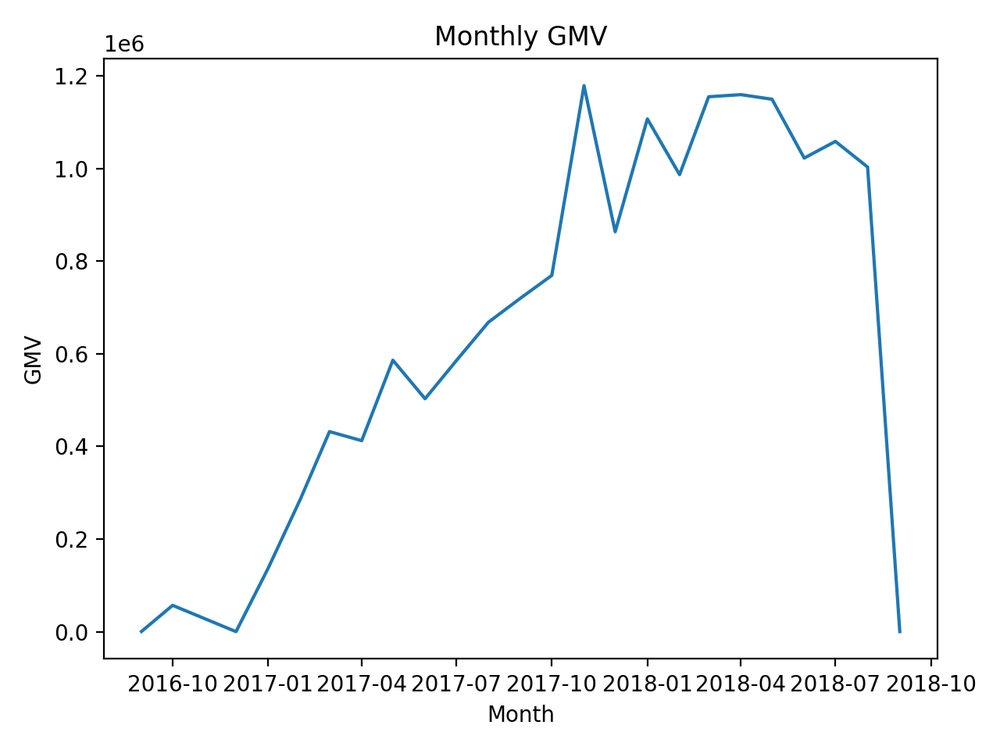

# Olist 电商经营分析｜把 9 张业务表变成经营决策看板



    

> 把 Kaggle 的 Olist 多表电商数据，按真实公司的数据链路完整跑通：**落库 → 数仓宽表 → KPI 分析 → 看板交付**。不虚构数字——下面每张图表都能用仓库里的 SQL 和脚本重新生成。

## 核心发现：履约延迟是口碑的头号杀手

把 9.6 万笔有履约时效的订单按延迟程度分桶后，**评分随着延迟一档一档塌下去**：

| 履约表现 | 平均评分 | 订单量 |
| --- | :---: | :---: |
| 准时或提前 | **4.29** | 89,936 |
| 迟到 1-2 天 | 3.52 | 1,370 |
| 迟到 3-5 天 | 2.47 | 1,400 |
| 迟到 6 天以上 | **1.74** | 3,764 |

对运营的含义：差评治理的抓手不在客服话术，在**履约时效的最后一公里**——把"迟到 6 天+"的订单量压下去，评分大盘自然回来。



月度经营基线（以 2018-05 为例：6,873 单、GMV 115 万雷亚尔、AOV 167.8；2018-09 起为数据截断期）：



更多图表：[月度订单量](reports/figures/monthly_orders.png)、[支付方式占比](reports/figures/payment_type_presence.png)、[Top 类目 GMV](reports/figures/top_categories_gmv.png)。

## 为什么做这个项目

电商运营方最常见的困境不是没流量，而是**"单量看着不少，利润和口碑却上不来"**——问题出在哪个环节，没人说得清：是品类结构不行？履约太慢拖垮了评分？还是部分卖家在拖后腿？数据散在订单、支付、评价、卖家、商品等 9 张表里，口径互相对不上，任何回答都要现拼一次。

这个项目把"感觉卖不动"变成**可定位、可追踪的经营问题**：

1. **口径统一**——把 9 张散表整合成订单级 KPI 宽表，GMV、AOV、准时履约率、评分、支付结构从此只有一个版本；
2. **问题可定位**——沿品类、商家、履约环节三条线下钻，识别高贡献品类、慢履约订单与低评分商家的关联，把"口碑差"落到具体环节；
3. **结论可交付**——Python 自动生成经营报告，Power BI 看板让运营团队不用写 SQL 就能持续盯着自己该管的品类和卖家。

一句话：给电商经营装上一套**从数据到决策的仪表盘**，让每个"为什么"都能下钻到具体环节和卖家。

---

## 这个项目做了什么

| 环节 | 产出 |
| --- | --- |
| 数据建模 | 9 张业务表落 MySQL，构建订单级 KPI 宽表、类目月度趋势、商家评分卡三类分析视图 |
| ETL | Docker 化 Python 管道：分批导入、清洗、geolocation 按邮编前缀聚合 |
| 经营分析 | GMV、订单量、AOV、准时履约率、评分、支付结构、履约时效与差评的关系 |
| 可视化 | Python 自动生成图表与 Markdown 经营报告；Power BI 看板页面结构与 DAX 指标口径 |
| 工程化 | 数据字典、pipeline 流程图、Docker Compose 一键启动，全链路可复现 |

---

## 项目亮点

- **多源业务数据建模**：将 9 份 CSV（订单/明细/支付/评价/客户/卖家/商品/地理/类目）落库到 **MySQL**，构建可复用的分析视图（KPI 宽表、商家评分卡、履约时效分解等）。
- **完整分析闭环**：用 **Python** 生成可复现分析（KPI、异常诊断、驱动因素分析），并自动输出图表与 Markdown 报告。
- **可视化交付**：提供 **PowerBI 看板设计方案**（页面结构 + DAX 指标口径），支持直连 MySQL 或使用导出 CSV。
- **工程化可复现**：用 **Docker Compose** 一键启动 MySQL + ETL/分析环境。

## 快速开始

```bash
# 1. 一键启动 MySQL
docker compose up -d mysql

# 2. 运行 ETL（建表 + 分批导入 + 生成视图）
docker compose run --rm etl python -m src.etl.load_to_mysql --all
docker compose run --rm etl python -m src.etl.create_views

# 3. 生成分析报告与图表
docker compose run --rm etl python -m src.analysis.generate_report
```

数据来源：[Kaggle - Brazilian E-Commerce Public Dataset by Olist](https://www.kaggle.com/datasets/olistbr/brazilian-ecommerce/data)，9 份 CSV 放入 `data/raw/`（`olist_geolocation_dataset.csv` 约 100 万行，ETL 时按 zip 前缀自动聚合）。Power BI 直连 `localhost:3306` 的 `olist` 库，选择 `vw_order_kpi` / `vw_seller_scorecard` / `vw_category_monthly` 视图即可；无驱动时可运行 `src/analysis/export_for_powerbi.py` 导出 CSV。

## 常见坑位（提前避雷）

- `customers` 表：同一自然人多次下单会出现多个 `customer_id`，**复购/留存必须用 `customer_unique_id`**。
- `payments` 表：同一订单可能多条支付记录，分析支付结构要按 `order_id` 汇总。
- `geolocation` 表：同一邮编前缀可能有多条坐标，本项目按 zip 前缀聚合（mean lat/lng + mode city/state）。

## 目录结构

```
.
├─ data/raw/              # 放 Kaggle 原始 CSV（gitignore）
├─ sql/                   # 01_schema.sql 建表 DDL · 02_views.sql 分析视图
├─ src/etl/               # load_to_mysql · create_views
├─ src/analysis/          # generate_report · export_for_powerbi
├─ reports/               # eda_summary.md + figures/（可复现图表）
├─ powerbi/               # dashboard_spec.md 看板设计与 DAX 口径
├─ docs/                  # 数据字典 · pipeline 流程图
└─ docker-compose.yml     # 一键启动
```

## License

MIT
