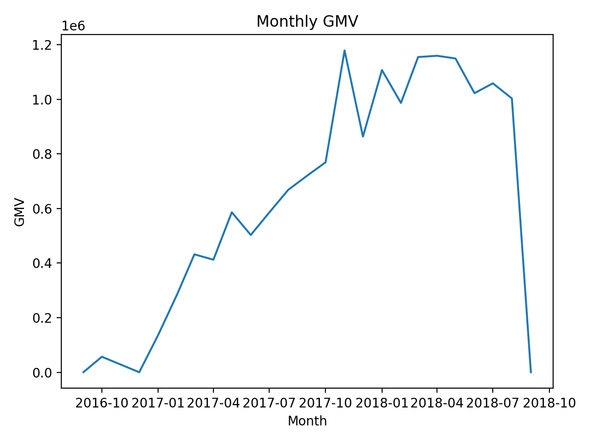
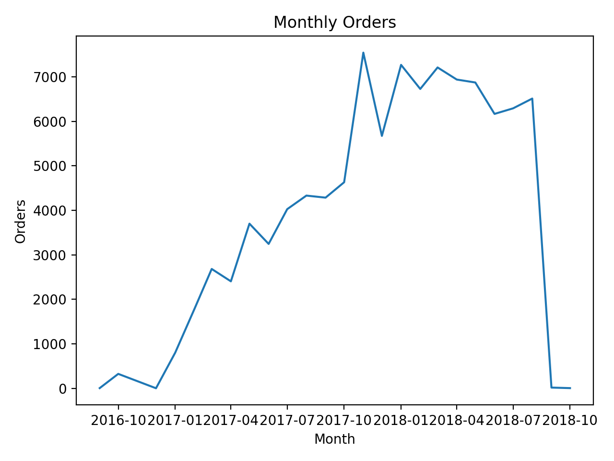
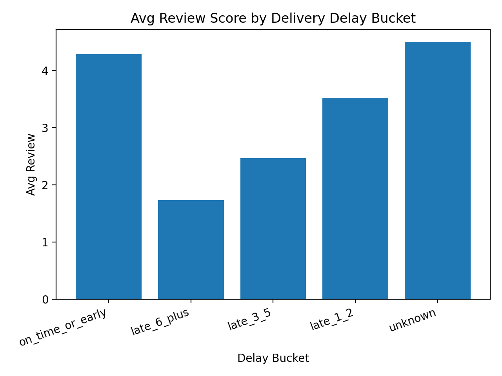
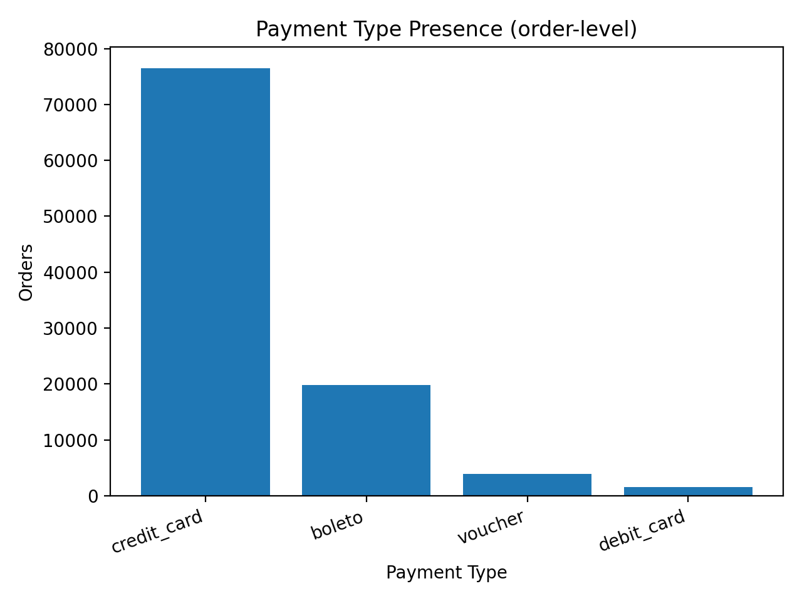
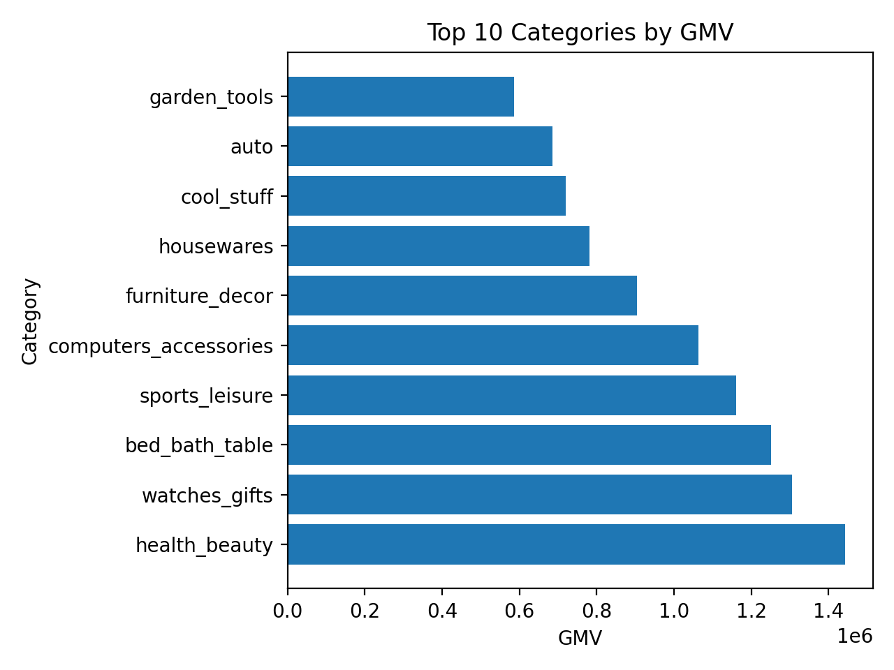

# Olist 电商经营分析（自动生成报告）

## 核心KPI（按月）

| month      |   orders |           gmv |     aov |
|:-----------|---------:|--------------:|--------:|
| 2018-05-01 |     6873 |   1.14978e+06 | 167.778 |
| 2018-06-01 |     6167 |   1.02268e+06 | 166.019 |
| 2018-07-01 |     6292 |   1.05873e+06 | 168.775 |
| 2018-08-01 |     6512 |   1.00331e+06 | 155.503 |
| 2018-09-01 |       16 | 166.46        | 166.46  |
| 2018-10-01 |        4 | nan           | nan     |

## 履约时效与口碑

| delay_bucket     |   avg_review |   orders |
|:-----------------|-------------:|---------:|
| on_time_or_early |      4.29258 |    89936 |
| late_6_plus      |      1.73549 |     3764 |
| late_3_5         |      2.46845 |     1400 |
| late_1_2         |      3.5178  |     1370 |
| unknown          |      4.5     |        8 |

## 图表

